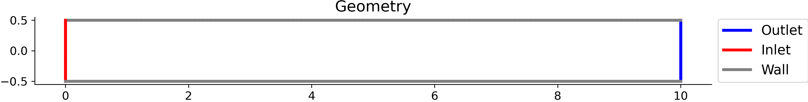
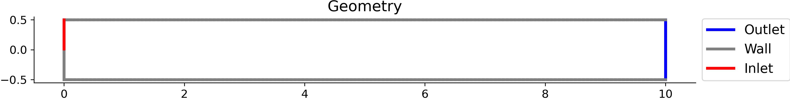
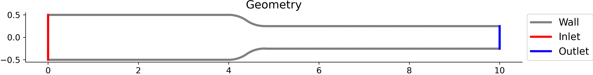

# PI-GCNN: Physics-Informed Graph Convolutional Network for Carreau–Yasuda Flow

This repository contains the code and results for a physics-informed graph convolutional framework (**PI-GCNN**) that solves **steady, incompressible, non-Newtonian flow** in two-dimensional channels on irregular domains. It is compared against a conventional **PINN** (fully connected network) in both:

- **Forward problems**: no measurement data, only physics and boundary conditions.
- **Ill-posed (inverse) problems**: the inlet velocity profile is unknown and is inferred from sparse velocity measurements.

Both models predict the velocity $(u, v)$ and pressure $p$, and are validated against CFD reference solutions.

---

## Contents

- [Governing equations](#governing-equations)
- [Rheological model and parameters](#rheological-model-and-parameters)
- [Boundary conditions](#boundary-conditions)
- [Models](#models)
- [Ill-posed formulation](#ill-posed-formulation)
- [Case summary](#case-summary)
- [Main results](#main-results)
- [Post-processing and validation](#post-processing-and-validation)

---

## Governing equations

Steady, incompressible, laminar flow:

```math
\nabla \cdot \mathbf{u} = 0
```

```math
\rho\, (\mathbf{u} \cdot \nabla \mathbf{u}) = -\nabla p + \nabla \cdot \boldsymbol{\tau}
```

with the generalized-Newtonian stress

```math
\boldsymbol{\tau} = 2\,\eta(\dot{\gamma})\,\mathbf{D}, \qquad
\mathbf{D} = \tfrac{1}{2}\left(\nabla \mathbf{u} + \nabla \mathbf{u}^{T}\right)
```

Shear-rate magnitude:

```math
\dot{\gamma} = \sqrt{2\,\mathbf{D}:\mathbf{D}}
= \sqrt{2\left(\frac{\partial u}{\partial x}\right)^2 + 2\left(\frac{\partial v}{\partial y}\right)^2 + \left(\frac{\partial u}{\partial y} + \frac{\partial v}{\partial x}\right)^2}
```

---

## Rheological model and parameters

The shear-thinning behavior is described by the **Carreau–Yasuda** model:

```math
\eta(\dot{\gamma}) = \eta_\infty + (\eta_0 - \eta_\infty)\left[1 + (\lambda\,\dot{\gamma})^{a}\right]^{\frac{n-1}{a}}
```

Two fluids are used:

| Parameter | Synthetic fluid (low complexity) | Xanthan gum 500 ppm (high complexity) |
|-----------|:---:|:---:|
| Density $\rho$ (kg/m³) | 1.0 | 1000.0 |
| Zero-shear viscosity $\eta_0$ (Pa·s) | 0.01 | 0.6491 |
| Infinite-shear viscosity $\eta_\infty$ (Pa·s) | 0.005 | 0.0016 |
| Time constant $\lambda$ (s) | 1.0 | 49.70 |
| Power-law index $n$ | 0.5 | 0.4303 |
| Yasuda parameter $a$ | 2.0 | 1.9900 |

---

## Boundary conditions

| Boundary | Condition |
|----------|-----------|
| Inlet | Prescribed velocity profile, $v = 0$ (forward problems); unknown in the ill-posed problem |
| Walls / obstacle | No-slip: $u = v = 0$ |
| Outlet | Fixed pressure: $p = 0$ |

The inlet profile and Reynolds number of each case (Re from 16 to 100, all laminar) are listed in the supplementary material of the paper.

---

## Models

### Conventional PINN

| Item | Setting |
|------|---------|
| Network | MLP, input $(x, y)$, hidden layers $[64, 64, 64]$, output $(u, v, p)$, tanh |
| Derivatives | Automatic differentiation |
| Boundary conditions | Soft constraints (penalty terms in the loss) |
| Loss | $\mathcal{L} = \mathcal{L}_{\text{BC}} + \mathcal{L}_{\text{PDE}}$ |

### PI-GCNN (proposed)

| Item | Setting |
|------|---------|
| Graph | Mesh nodes as vertices, mesh connectivity as edges, normalized adjacency matrix |
| Layers | Three gated graph-convolution layers $[64, 64, 64]$ |
| Input | $(x, y)$ with Fourier feature embedding |
| Gating | Triple pathway $\mathbf{U}, \mathbf{V}, \mathbf{Z}$ |
| Activation | Trainable $\tanh(\alpha x)$ on the $\mathbf{U}$ and $\mathbf{V}$ pathways |
| Derivatives | Moving least-squares (MLS) nodal differentiation |
| Boundary conditions | **Hard constraints** via binary masks on boundary nodes (Dirichlet) |
| Loss | $\mathcal{L} = \mathcal{L}_{\text{PDE}}$ only (the boundary loss is exactly zero) |

### Training (both models)

1. **Adam**, learning rate $10^{-3}$ for the first 5000 epochs, then $10^{-4}$, until the loss plateaus.
2. **L-BFGS** refinement: learning rate 0.01, history size 50, up to 2000 iterations, strong Wolfe line search.

Hardware: NVIDIA A100 (40 GB). A structured mesh with 4700 nodes and 8 neighbors per node was used for the PI-GCNN.

---

## Ill-posed formulation

The inlet velocity profile is **not** provided. Only sparse interior velocity measurements $\{(x^{(m)}, y^{(m)}, u^{(m)}, v^{(m)})\}$ are available, and the pressure is entirely unobserved. The model must:

- satisfy the Navier–Stokes equations,
- match the measurements through a data loss, $\mathcal{L} = \mathcal{L}_{\text{PDE}} + \lambda_{\text{data}}\,\mathcal{L}_{\text{data}}$ (with $\lambda_{\text{data}} = 10$),
- reconstruct the unknown inlet profile.

The effects of **number of measurements** (20, 50, 100), **spatial sampling pattern** (sinusoidal, hyperbolic tangent, cross-shaped) and **noise level** (0%, 10%, 20% Gaussian) are studied on Case 2a.

---

## Case summary

| Case | Geometry | Fluid |
|------|----------|-------|
| [Case 1](#case-1) | Plain rectangular channel | Synthetic (low complexity) |
| [Case 2a](#case-2a) | Rectangular channel with an additional wall segment on the left boundary | Synthetic (low complexity) |
| [Case 2b](#case-2b) | Same geometry as Case 2a | Xanthan gum 500 ppm (high complexity) |
| [Case 3](#case-3) | Channel with varying height, constricted in the middle section | Synthetic (low complexity) |
| [Case 4](#case-4) | Rectangular channel with a cylindrical obstacle in the middle | Synthetic (low complexity) |

The ill-posed study is performed on Case 2a.

---

### Case 1

- **Geometry:** Plain rectangular channel (pressure-driven flow)
- **Fluid:** Synthetic (low complexity)

<p align="center">
  
</p>

---

### Case 2a

- **Geometry:** Rectangular channel with an additional wall segment on the left boundary
- **Fluid:** Synthetic (low complexity)

<p align="center">
  
</p>

---

### Case 2b

- **Geometry:** Same as Case 2a
- **Fluid:** Xanthan gum 500 ppm (high complexity, strongly shear-thinning)

<p align="center">
  
</p>

---

### Case 3

- **Geometry:** Channel with varying height, constricting in the middle section
- **Fluid:** Synthetic (low complexity)

<p align="center">
  
</p>

---

### Case 4

- **Geometry:** Rectangular channel with a cylindrical obstacle at the center
- **Fluid:** Synthetic (low complexity)

<p align="center">
  
</p>

---

## Main results

### Forward problems

Range-normalized $L_2$ errors (%) against CFD:

| Case | $u$ PINN | $u$ PI-GCNN | $v$ PINN | $v$ PI-GCNN | $p$ PINN | $p$ PI-GCNN |
|------|:---:|:---:|:---:|:---:|:---:|:---:|
| 1  | 0.92  | 0.78 | 84.36 | 105.41 | 1.81  | 0.63 |
| 2a | 3.61  | 0.85 | 17.00 | 2.82   | 3.39  | 0.98 |
| 2b | 65.00 | 3.93 | 65.06 | 8.57   | 80.78 | 3.63 |
| 3  | 63.88 | 3.85 | 90.35 | 6.01   | 79.93 | 7.22 |
| 4  | 81.74 | 3.33 | 92.49 | 3.76   | 89.50 | 4.99 |

> In Case 1 the reference $v$ is nearly zero, so the range-normalized error of $v$ is not a meaningful metric for comparing the models.

PI-GCNN is also about **1.5–1.7× faster per epoch** than the conventional PINN and reaches a lower minimum training loss in all cases.

### Ablation study (Case 3)

The full PI-GCNN reduces the error from 57.64% (graph only) to **1.88%**. Hard boundary-condition enforcement gives the largest single improvement (57.64% to 5.71%).

### Ill-posed problem (Case 2a, PI-GCNN, inlet profile $L_2$ error)

| Study | Setting | Error |
|-------|---------|:---:|
| Number of data points | 20 / 50 / 100 | 12.99% / 11.00% / 6.06% |
| Sampling pattern (100 pts) | cross / tanh / sinusoidal | 18.55% / 21.32% / 6.06% |
| Noise (100 pts, sinusoidal) | 20% / 10% / 0% | 19.86% / 10.34% / 6.06% |

PI-GCNN also preserves the sharp kink of the inlet profile that the conventional PINN smooths out.

---

## Post-processing and validation

For every case the pipeline produces:

- Velocity contours $(u, v)$ and pressure field
- Effective viscosity distribution $\eta$
- Relative (range-normalized) error maps and $L_2$ error norms
- Loss histories of both models
- For ill-posed runs: the reconstructed inlet profile at $x = 0$ against the reference

Reference solutions come from CFD simulations.

## Limitations

- Mask-based hard enforcement works only for Dirichlet boundary conditions.
- Graph aggregation is convolutional; attention-based aggregation is a possible extension.
